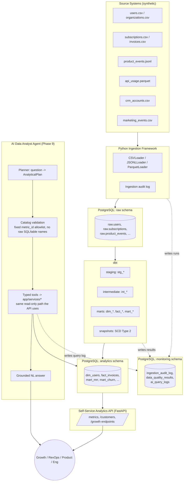

# Architecture

## Overview

The AI-Powered Growth Data Platform is a batch ELT system that centralizes data from a fictional
AI SaaS company's fragmented source systems (application DB, billing, product usage events, CRM,
marketing, API logs) into a single PostgreSQL warehouse, models it with dbt into analytics-ready
marts, and serves it through a self-service REST API and a governed AI query agent.

## Pipeline flow

```
Sources (CSV / JSONL / Parquet)
        |
        v
Python ingestion (loaders + audit log)
        |
        v
PostgreSQL: raw schema
        |
        v
dbt staging layer (cleaning, typing, deduplication)
        |
        v
dbt intermediate layer (reusable business transforms)
        |
        v
dbt marts (dims/facts, growth + revenue marts)
        |
        v
Analytics API (FastAPI, read models only)
        |
        v
AI Data Analyst Agent (question -> validated plan against a fixed metric catalog -> one typed,
read-only tool call reusing the Analytics API's own service layer -> grounded NL answer)
```

(As actually built in Phase 9 - see "Why the AI agent never gets raw database credentials" below
for why this ended up simpler than the SQL-generation-plus-validator design originally sketched
for this diagram.)

## Diagram



## Schema layout

| Schema | Owner | Purpose |
|---|---|---|
| `raw` | Ingestion | Untransformed landing tables, one per source file. Append-only or upserted by natural/source key. |
| `staging` | dbt | 1:1 cleaned views over `raw`: renamed columns, standardized types, normalized strings, deduplication. No business logic. |
| `intermediate` | dbt | Reusable business transforms joining multiple staging models (e.g. subscription history, customer revenue, conversion funnels). |
| `analytics` | dbt | Business-facing marts: dimensions, facts, and growth/revenue marts. This is the only schema the API and AI agent read from. |
| `monitoring` | Ingestion + dbt + API | Operational metadata: ingestion audit log, data quality results, AI agent query logs. |
| `snapshots` | dbt (Phase 6) | SCD Type 2 history for subscriptions and CRM accounts (`snap_subscriptions`, `snap_crm_accounts`). |

## Why schemas instead of separate databases

Keeping every layer in one PostgreSQL database, separated by schema, keeps dbt `ref()`/`source()`
resolution simple, avoids cross-database query limitations, and mirrors how most production dbt
warehouses on a single Postgres/Redshift/Snowflake instance are organized. `dbt/macros/generate_schema_name.sql`
(added in Phase 3) overrides dbt's default `<target_schema>_<custom_schema>` naming so a model
tagged `+schema: staging` lands in the literal `staging` schema Phase 1 provisioned, not
`analytics_staging`.

## Why the AI agent never gets raw database credentials

As actually built in Phase 9, the agent doesn't generate or execute SQL at all - there's nothing
for a SQL validator to validate. The LLM only ever chooses among a fixed, closed set of `metric_id`
values (`app/agent/catalog.py`); each one maps to exactly one typed tool function in
`app/agent/tools.py`, which calls the same `app/services/*` functions the Phase 8 Analytics API
itself uses - the same fixed, parameterized queries. There is no `execute_sql(sql)`-style tool, no
client/model-supplied table or column name, and no write path. This is a simpler and strictly more
constrained design than the SQL-generation-plus-validator approach originally sketched here in
Phase 1 - see [ai_data_analyst_agent.md](ai_data_analyst_agent.md) for the full rationale and the
explicit list of what was intentionally left out of scope.

As of Phase 10, this is also enforced at the **database level**, not just by the agent's own code
having no write path: both the agent and the rest of the Analytics API now read through
`app/db/session.py`'s `read_only_engine`, which puts every connection into a database-enforced
read-only transaction (PostgreSQL itself rejects any write attempt, independent of the connecting
role's grants), backed by a dedicated least-privilege `analytics_ro` role with `SELECT` on
`analytics`/`monitoring` only and exactly one write exception (`INSERT` on the agent's own audit
table, `monitoring.ai_query_logs`). See
[security_and_sql_validation.md](security_and_sql_validation.md) §3 for how this was verified
against the live database, and why the audit log's one permitted write deliberately uses a
separate, non-read-only session rather than the same one used for analytical reads.

## Local run

```bash
cp .env.example .env
docker compose up -d
curl http://localhost:8000/health
```

`postgres` and `analytics-api` both expose Docker healthchecks; `docker compose up -d` will not
report the stack healthy until Postgres is accepting connections and `/health` returns 200.

## What's implemented so far

**Phase 1** - Repository and Docker skeleton; PostgreSQL schema bootstrap (`raw`, `staging`,
`intermediate`, `analytics`, `monitoring`); FastAPI service with a DB-backed `/health` check; empty
dbt project shell.

**Phase 2** - Deterministic synthetic data generation (`scripts/generate_data.py`) for 8 source
files with realistic business correlations and intentionally injected quality issues; a reusable
Python ingestion framework (`ingestion/`) that loads them into `raw.*` idempotently, with full audit
(`monitoring.ingestion_runs`) and rejection tracking (`monitoring.rejected_records`). See
[ingestion.md](ingestion.md).

**Phase 3** - A full dbt staging layer: `raw.*` -> `dbt source()` (with freshness checks against
`_ingested_at`) -> `stg_<domain>__<entity>` views in the `staging` schema. Standardizes email,
country code, currency, and categorical values; deterministic deduplication by business key; safe
numeric/timestamp casting (`NULL` on parse failure, never `0`); WARN-vs-ERROR test severity policy
that treats Phase 2's intentional orphaned-FK/messy-value injections as expected observations rather
than build-breaking failures. See [dbt_staging.md](dbt_staging.md) and [data_dictionary.md](data_dictionary.md).

**Phase 4** - A dbt intermediate layer: `stg_*` views -> 9 `int_*` models in the `intermediate`
schema, establishing reusable business entities (subscription history, acquisition attribution,
revenue facts, daily product/API usage, subscription-milestone timelines, customer activity,
conversion-funnel milestones, customer lifecycle) with explicit, verified join-cardinality
guarantees (no row multiplication) and a documented user-vs-organization "customer identity"
convention. Still no final KPIs (MRR, churn, conversion rate) - those are Phase 5. See
[dbt_intermediate.md](dbt_intermediate.md) and [data_dictionary.md](data_dictionary.md).

**Phase 5** - Dimensional models (`dim_users`, `dim_organizations`, `dim_plans`, `dim_date`) and
core facts (`fact_subscriptions`, `fact_invoices`, `fact_product_usage`, `fact_api_usage`) in the
`analytics` schema, plus 6 Growth marts and 7 Revenue marts (`mart_mrr`, `mart_arr`,
`mart_customer_churn`, `mart_revenue_churn`, `mart_customer_ltv`, `mart_arpu`, `mart_api_usage`,
`mart_daily_growth`, `mart_trial_conversion`, `mart_acquisition_channels`,
`mart_retention_cohorts`, `mart_feature_adoption`, `mart_enterprise_growth`). MRR/ARR/ARPU are
explicitly documented as point-in-time snapshots, not historical time series - this source has no
status-change history to reconstruct one from (that's what Phase 6 snapshots are for). See
[dbt_marts.md](dbt_marts.md) and [business_metrics.md](business_metrics.md).

**Phase 6** - `fact_product_usage`, `fact_api_usage`, and `fact_invoices` converted to
`materialized='incremental'` (delete+insert, a configurable `incremental_lookback_days` window
filtered on `_ingested_at`, never business event time). Two dbt snapshots
(`snap_subscriptions`, `snap_crm_accounts`) added for SCD Type 2 history, using the `timestamp`
strategy on each source's genuine `updated_at` field, landing in a new `snapshots` schema.
`fact_subscriptions` was deliberately left as a full-refresh table - `raw.subscriptions` is a
current-state-only source with no event stream to process incrementally; that's precisely the
problem the snapshot solves instead. See [incremental_processing.md](incremental_processing.md)
for the full strategy, a real bug this phase found and fixed (a NULL-unique-key issue in the two
aggregate facts), and the documented limits of what snapshots can and cannot recover.

**Phase 7** - A persistent data quality/observability framework: `monitoring.quality_runs` +
`monitoring.data_quality_results` (new tables, same audit-run + detail-table convention as
Phase 2's `ingestion_runs`/`rejected_records`), and `scripts/run_quality_checks.py` running a
16-check catalog across structural, referential, business-rule, freshness, snapshot, and
volume-anomaly categories. Extends - never replaces - Phase 3's WARN-vs-ERROR policy for
intentional synthetic-data anomalies; the 9 pre-existing dbt WARNs remain exactly as visible as
before. See [data_quality_observability.md](data_quality_observability.md).

**Phase 8** - A read-only self-service analytics API (FastAPI) over the `analytics.*`/`monitoring.*`
layer: 17 endpoints across growth, revenue, product usage, customers, and data-quality summaries,
plus `/health` (pure process liveness) and `/ready` (DB + required analytics objects reachable -
the Docker healthcheck target, replacing Phase 1's DB-backed `/health`). Every query is a fixed,
parameterized SQL string - no client-supplied SQL or table names, currency is never mixed across
rows, and `customer_id` is always `organization_id`. See [analytics_api.md](analytics_api.md).

**Phase 9** - A constrained AI Data Analyst Agent (`POST /api/v1/agent/ask`, `GET
/api/v1/agent/health`) layered on top of Phase 8: question -> validated plan (checked against a
fixed, already-documented metric catalog) -> exactly one read-only tool call reusing the existing
`app/services/*` functions -> an answer strictly grounded in that tool's returned data. No
arbitrary SQL execution, no write path, no ingestion/dbt triggering. Ollama (local-only) is the
default LLM provider - the platform runs with zero commercial API credentials; OpenAI/Anthropic are
opt-in only, never an implicit fallback. See
[ai_data_analyst_agent.md](ai_data_analyst_agent.md).

**Phase 10** - A security-hardening audit of Phases 8-9, not a rebuild: confirmed (and proved with
live-injection tests) that every `app/services/*`/`app/agent/tools.py` query already used bound
parameters correctly; added database-enforced read-only transactions for every analytics/agent
read (`app/db/session.py`'s `read_only_engine`) backed by a new least-privilege `analytics_ro`
Postgres role (`SELECT` only, plus one documented `INSERT` exception for the agent's own audit
log); hardened `AnalyticalPlan` against unexpected fields and oversized/malformed filter values;
added a currency-fabrication guard on LLM-generated answers; and added a standalone, **unwired**
defensive SQL-validation module (`app/security/sql_validator.py`) for a possible future
controlled-SQL feature - nothing in this platform executes client- or model-supplied SQL today. See
[security_and_sql_validation.md](security_and_sql_validation.md).

**Phase 11** - A GitHub Actions automation layer over Phases 1-10, not a behavior change: lint +
unit tests (no database, no live LLM) run on every PR/push; a Docker Compose config/build/liveness
job; a `dbt build` + PostgreSQL integration job against a disposable, freshly-provisioned database
that exercises the real `analytics_ro` role (never a superuser standing in for it); and a separate
dependency/secret-scanning workflow. The established dbt quality baseline is reproduced from a
completely fresh database and compared explicitly - a genuine `ERROR` always fails the build; an
intentional baseline drift is a reviewable warning, never silently absorbed. See
[ci_cd_and_testing.md](ci_cd_and_testing.md).

## Pipeline flow (updated)

```
Source files (Phase 2)
        |
        v
Python ingestion (Phase 2)
        |
        v
raw.* (PostgreSQL)
        |
        v
dbt sources + freshness (Phase 3)
        |
        v
dbt staging: stg_<domain>__<entity> (Phase 3) --> dbt snapshots: snap_* (Phase 6, SCD Type 2)
        |
        v
dbt intermediate: int_<entity> (Phase 4)
        |
        v
dbt dimensions + facts: dim_*, fact_* (Phase 5; 3 facts incremental as of Phase 6)
        |
        v
dbt marts: mart_<growth|revenue>_* (Phase 5)
        |
        v
scripts/run_quality_checks.py --> monitoring.quality_runs / data_quality_results (Phase 7)
        |
        v
FastAPI analytics API: /api/v1/* (Phase 8)
        |
        v
AI Data Analyst Agent: /api/v1/agent/* (Phase 9)
        |
        v
Security hardening: read_only_engine + analytics_ro role + SQL validator (Phase 10)
        |
        v
GitHub Actions CI/CD: lint + unit + docker-validate + dbt-and-integration + security scans (Phase 11)
        |
        v
Documentation audit + evidence-based performance review (Phase 12) <-- you are here
```

Raw ingestion (Python, Phase 2) and analytical transformation (dbt, Phase 3+) are deliberately
separate concerns: ingestion's job is "land the source data faithfully, however messy"; dbt's job
starts at `staging` and is "make it trustworthy." Nothing upstream of `raw.*` is ever modified to
make a dbt model easier to write.

Not yet implemented: general natural-language-to-SQL, a standalone API authentication/
authorization layer, and request-size-limiting middleware - the Phase 9 agent remains deliberately
scoped to a fixed metric catalog (see [ai_data_analyst_agent.md](ai_data_analyst_agent.md) "What
this agent is, and is not"), and Phase 10's SQL validator
(`app/security/sql_validator.py`) is a defensive boundary that is explicitly **not** wired into any
endpoint (see [security_and_sql_validation.md](security_and_sql_validation.md) §2 and "Known
limitations").

## Database-enforced vs. application-level controls

Worth stating explicitly, since the two are easy to conflate:

- **Database-enforced** (PostgreSQL itself refuses the action, independent of any Python code):
  the `read_only_engine`'s `postgresql_readonly=True` transaction setting (any write attempt raises
  `ReadOnlySqlTransaction`, even for a fully-privileged role); the `analytics_ro` role's own GRANTs
  (`SELECT` on `analytics`/`monitoring` only, `INSERT` on `monitoring.ai_query_logs` only - enforced
  by Postgres's privilege system, not by this application remembering not to misuse its own
  connection); dbt's/ingestion's own unique/not-null/foreign-key constraints where declared.
- **Application-level** (this codebase's own logic, not something Postgres would reject on its
  own if bypassed): the AI Agent's fixed metric catalog and typed-tool dispatch (`app/agent/
  catalog.py`/`executor.py` - there is no SQL statement for Postgres to refuse, because none is
  ever constructed from untrusted input); `AnalyticalPlan`'s field/length/control-character
  validation; the currency-fabrication guard on LLM answers; every `app/services/*.py` query's use
  of bound parameters (correct *application* practice - Postgres has no concept of "this value came
  from a client" to enforce on its own); FastAPI's request-schema validation (`max_length`,
  `ConfigDict(extra="forbid")`, etc.).

Both categories matter, but they fail differently: an application-level control has a bug class
("what if this code path is skipped"); a database-enforced one does not, for the specific action it
covers - which is exactly why Phase 10 added database-level read-only enforcement in addition to
(not instead of) the application-level design that already existed.

## Performance

Phase 12 investigated PostgreSQL query plans, API/agent request latency, dbt build time, and
ingestion throughput, using `EXPLAIN ANALYZE`, a new repeatable benchmark script
(`scripts/benchmark.py`), and the existing dbt/quality tooling. **Conclusion: no code-level
performance change was made** - every area investigated was already correct by design or already
fast at this project's data scale, with evidence recorded for each. Full investigation, baseline
numbers, and the reasoning for not adding speculative indexes/caching: [performance.md](performance.md).
