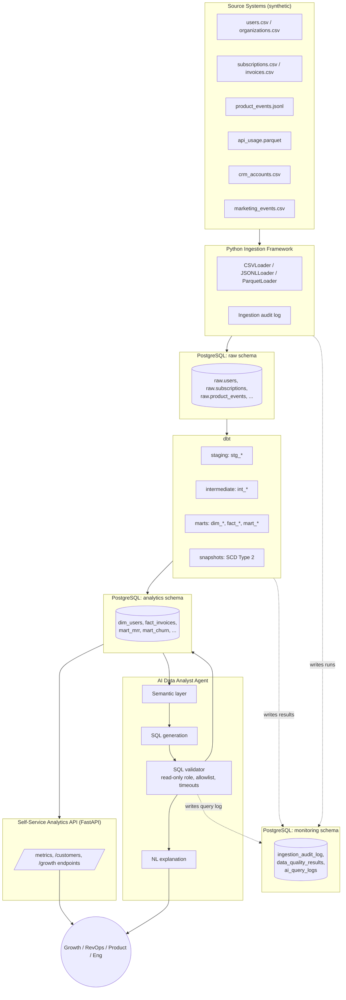

# Architecture

## Overview

The AI-Powered Growth Data Platform is a batch ELT system that centralizes data from a fictional
AI SaaS company's fragmented source systems (application DB, billing, product usage events, CRM,
marketing, API logs) into a single PostgreSQL warehouse, models it with dbt into analytics-ready
marts, and serves it through a self-service REST API and a governed AI query agent.

## Pipeline flow

```
Sources (CSV / JSONL / Parquet)
        |
        v
Python ingestion (loaders + audit log)
        |
        v
PostgreSQL: raw schema
        |
        v
dbt staging layer (cleaning, typing, deduplication)
        |
        v
dbt intermediate layer (reusable business transforms)
        |
        v
dbt marts (dims/facts, growth + revenue marts)
        |
        v
Analytics API (FastAPI, read models only)
        |
        v
AI Data Analyst Agent (semantic layer -> SQL -> validator -> read-only execution -> NL answer)
```

## Diagram



## Schema layout

| Schema | Owner | Purpose |
|---|---|---|
| `raw` | Ingestion | Untransformed landing tables, one per source file. Append-only or upserted by natural/source key. |
| `staging` | dbt | 1:1 cleaned views over `raw`: renamed columns, standardized types, normalized strings, deduplication. No business logic. |
| `intermediate` | dbt | Reusable business transforms joining multiple staging models (e.g. subscription history, customer revenue, conversion funnels). |
| `analytics` | dbt | Business-facing marts: dimensions, facts, and growth/revenue marts. This is the only schema the API and AI agent read from. |
| `monitoring` | Ingestion + dbt + API | Operational metadata: ingestion audit log, data quality results, AI agent query logs. |

## Why schemas instead of separate databases

Keeping every layer in one PostgreSQL database, separated by schema, keeps dbt `ref()`/`source()`
resolution simple, avoids cross-database query limitations, and mirrors how most production dbt
warehouses on a single Postgres/Redshift/Snowflake instance are organized. `dbt/macros/generate_schema_name.sql`
(added in Phase 3) overrides dbt's default `<target_schema>_<custom_schema>` naming so a model
tagged `+schema: staging` lands in the literal `staging` schema Phase 1 provisioned, not
`analytics_staging`.

## Why the AI agent never gets raw database credentials

The agent only ever executes through a dedicated read-only PostgreSQL role, against an allowlist of
`analytics.*` tables, through a SQL validator that rejects anything but a single `SELECT` statement,
enforces a row limit, and applies a query timeout. See `docs/business_metrics.md` (Phase 17) and
`app/agent/sql_validator.py` (Phase 20) for the full design once implemented.

## Local run

```bash
cp .env.example .env
docker compose up -d
curl http://localhost:8000/health
```

`postgres` and `analytics-api` both expose Docker healthchecks; `docker compose up -d` will not
report the stack healthy until Postgres is accepting connections and `/health` returns 200.

## What's implemented so far

**Phase 1** - Repository and Docker skeleton; PostgreSQL schema bootstrap (`raw`, `staging`,
`intermediate`, `analytics`, `monitoring`); FastAPI service with a DB-backed `/health` check; empty
dbt project shell.

**Phase 2** - Deterministic synthetic data generation (`scripts/generate_data.py`) for 8 source
files with realistic business correlations and intentionally injected quality issues; a reusable
Python ingestion framework (`ingestion/`) that loads them into `raw.*` idempotently, with full audit
(`monitoring.ingestion_runs`) and rejection tracking (`monitoring.rejected_records`). See
[ingestion.md](ingestion.md).

**Phase 3** - A full dbt staging layer: `raw.*` -> `dbt source()` (with freshness checks against
`_ingested_at`) -> `stg_<domain>__<entity>` views in the `staging` schema. Standardizes email,
country code, currency, and categorical values; deterministic deduplication by business key; safe
numeric/timestamp casting (`NULL` on parse failure, never `0`); WARN-vs-ERROR test severity policy
that treats Phase 2's intentional orphaned-FK/messy-value injections as expected observations rather
than build-breaking failures. See [dbt_staging.md](dbt_staging.md) and [data_dictionary.md](data_dictionary.md).

**Phase 4** - A dbt intermediate layer: `stg_*` views -> 9 `int_*` models in the `intermediate`
schema, establishing reusable business entities (subscription history, acquisition attribution,
revenue facts, daily product/API usage, subscription-milestone timelines, customer activity,
conversion-funnel milestones, customer lifecycle) with explicit, verified join-cardinality
guarantees (no row multiplication) and a documented user-vs-organization "customer identity"
convention. Still no final KPIs (MRR, churn, conversion rate) - those are Phase 5. See
[dbt_intermediate.md](dbt_intermediate.md) and [data_dictionary.md](data_dictionary.md).

## Pipeline flow (updated)

```
Source files (Phase 2)
        |
        v
Python ingestion (Phase 2)
        |
        v
raw.* (PostgreSQL)
        |
        v
dbt sources + freshness (Phase 3)
        |
        v
dbt staging: stg_<domain>__<entity> (Phase 3)
        |
        v
dbt intermediate: int_<entity> (Phase 4) <-- you are here
        |
        v
dbt marts / analytics (Phase 5+ - not yet implemented)
```

Raw ingestion (Python, Phase 2) and analytical transformation (dbt, Phase 3+) are deliberately
separate concerns: ingestion's job is "land the source data faithfully, however messy"; dbt's job
starts at `staging` and is "make it trustworthy." Nothing upstream of `raw.*` is ever modified to
make a dbt model easier to write.

Everything else in the diagram above the "you are here" marker (marts, the API's business
endpoints, and the AI agent) is built out in later phases per the project plan.
